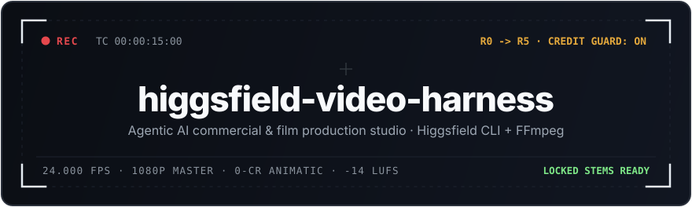

<p align="center">
  
</p>

<p align="center">
  <strong>An agentic AI video and commercial production studio for AI coding agents (Claude Code, Codex, Cursor, Antigravity, and more) + Higgsfield CLI + FFmpeg.</strong>
</p>

<p align="center">
  <a href="https://github.com/Dankosik/higgsfield-video-harness/actions/workflows/ci.yml"></a>
  <a href="LICENSE"></a>
  <a href="#prerequisites"></a>
  <a href="#prerequisites"></a>
  <a href="#multi-agent-architecture"></a>
</p>

<p align="center">
  <a href="#why-this-exists">Why This Exists</a> ·
  <a href="#key-features">Key Features</a> ·
  <a href="#how-it-works">How It Works</a> ·
  <a href="#quick-start">Quick Start</a> ·
  <a href="#example-walkthrough">Example Walkthrough</a> ·
  <a href="#supported-models--cost-routing">Supported Models</a> ·
  <a href="#multi-agent-architecture">Architecture</a> ·
  <a href="#commands--scripts">Commands</a> ·
  <a href="#faq">FAQ</a>
</p>

---

Turn a plain-English idea (and optional product photos) into a multi-shot, broadcast-ready **1080p AI commercial or short film**—without wasting credits on random video rolls.

You act as the **Creative Director**: pick among real visual options (`A / B / C`), react in everyday language (*"cooler morning light, matte leather instead of glossy, hold shot 2 longer"*), and approve each round's exact credit quote. A coordinated **multi-agent crew** handles ad concepts, scripts, storyboards, lookbooks, zero-video-credit animatics, model routing, visual QC, and FFmpeg mastering.

---

## Why This Exists

Generating a single AI clip is easy. Directing a coherent **multi-shot commercial** with AI video models usually breaks in four predictable ways:

| Common AI video problem | How `higgsfield-video-harness` solves it |
| --- | --- |
| **Slot-machine credit burn** from guessing prompts at 1080p | **Cheap proofs before expensive pixels:** `0 cr.` Web Unlimited first, then economy drafts, a `0`-video-credit Still Animatic, and `1080p` mastering **only** on approved shots. |
| **Runaway agent spending** or accidentally overwriting good takes | **Mechanical spend guard (`hf_guard.py`):** live `generate cost` quotes, dual caps (`Campaign cap` + per-round `--round-cap`), zero double-spend on timeouts, and immutable **`LOCKED`** assets. |
| **Characters, products, and lighting drifting across cuts** | **Two-step UUID anchoring + Continuity Lock:** real photos and locked Lookbook winners anchor every keyframe still, which then anchors `omni_reference` video motion across all shots. |
| **Broken timing, AI glitches, and amateur audio mixes** | **Pre-Dailies QC + FFmpeg mastering:** automated `ffprobe` defect detection, an unbiased Visual Critic (`reviewer-agent`), and two-pass `-14 LUFS` assembly with separate stems for DaVinci Resolve / Premiere Pro. |

---

## Key Features

- **6-Round Director ↔ Crew Loop (`R0` → `R5`):** Move smoothly from brief (`0 cr.`) to story & live quote (`0 cr.`), Lookbook (`A / B / C`), Keyframe Stills + playable Animatic (`0` video cr.), Draft Motion, and `1080p` Final Master.
- **Hard Credit Safety & Immutable Locks (`scripts/hf_guard.py`):** Every paid CLI call checks live `higgsfield generate cost`, enforces both a campaign-wide cap and a per-round `--round-cap`, serializes receipts with `flock`, resumes timed-out/failed downloads without double-charging, and refuses to touch `LOCKED` assets.
- **Web Unlimited-First (`0 cr.`) & Native-First Mastering:** Prioritizes `0 cr.` Unlimited runs on `higgsfield.ai` via browser handoff (pausing cleanly for manual login/CAPTCHA), falls back to low-cost `720p` CLI drafts (`seedance_2_0_mini`, `kling_4_0_flash`, `wan3_0`) or `seedance_2_5 --draft true`, and graduates approved cuts natively to `1080p` (`seedance_2_5 --draft_job_id --bitrate_mode high`, `kling4_0`, `wan3_0`, `veo3_1`, `cinematic_studio_video_4_0`)—never pixel-upscaling `480p` drafts into `1080p` masters (see [Mastering & Upscaling](.agents/skills/higgsfield-cli/references/mastering-and-upscaling.md)).
- **Narrative Architecture & Agency Pre-Production Built In:** Pairs [`video-narrative`](.agents/skills/video-narrative/SKILL.md) (`Narrative Lock`, `BUT / THEREFORE` causality, per-shot `Narrative job` + Deletion Test, `0.1s` instant-read semiotics, `2 + 2` subtext, and non-commercial story structures) with 4 commercial craft skills—[`ad-references`](.agents/skills/ad-references/SKILL.md), [`ad-concepts`](.agents/skills/ad-concepts/SKILL.md), [`ad-script`](.agents/skills/ad-script/SKILL.md), and [`ad-storyboard`](.agents/skills/ad-storyboard/SKILL.md)—for swap-tested pitches, timed 3-column scripts, read-aloud pacing checks, mute tests, and risky-shot `test_take_check` pilots.
- **Zero-Video-Credit Still Animatic (`make animatic`):** Watch and listen to your full spot (locked keyframes + voiceover + rough score) before spending a single credit on video generation.
- **5-Layer Self-Improving Memory (`taste-log.md` → `taste-active.md` → `brands/` & `studio/`):** Every Director reaction is logged with explicit `Supersedes:` links and compiled deterministically (`0` LLM tokens) into a conflict-free `taste-active.md` snapshot; post-campaign `R6` consolidation (`studio-retro`) mines CLI + Web Unlimited (`log-web`) + Visual Critic (`review-log.jsonl`) traces to propose gated ACE delta updates into `studio/{director,engine-memory,evolution-log}.md`, `brands/<brand>/taste.md`, and code validators.
- **Automated Technical QA, Narrative Blind Read & Visual Critic (`scripts/qa_media.py` + `reviewer-agent`):** Automatically catches black gaps, frozen tails, static clips, low bitrates, non-standard dimensions (`1918×1080`), sharpness spikes (`hf_edge_energy`), and overflowing voiceover windows (`100ms` RMS), builds `3x2` contact sheets, unscaled `1:1` native crop strips (`--crops`), and labeled `A / B / C` lookbook grids, and runs an isolated read-only Vision reviewer to filter pixel defects, continuity breaks, `TASTE_REGRESSION`s, and `NARRATIVE_DEFECT`s (Blind Viewer Read against `Narrative Lock`) before Dailies reach you.
- **Broadcast-Ready FFmpeg Mastering & Stems (`scripts/assemble.sh`):** FPS-locked re-encoded cuts with `lanczos` scaling (no concat freezes or A/V desync), two-pass `-14 LUFS` (`<= -1.0 dBTP`) loudness normalization, and unbaked `media/exports/stems/` (`video_only.mp4`, `diegetic.wav`, `vo.wav`, `music.wav`) ready for NLE finishing or optional Remotion graphics.
- **Zero Third-Party Python Packages:** Runs on pure **Python 3.11+ stdlib**, **FFmpeg/ffprobe**, and **ShellCheck**, backed by a comprehensive offline unit and integration test suite (`make check`).

---

## How It Works

Great commercials come from **emergent visual taste**, not giant upfront prompt walls. You never have to write camera jargon, CLI flags, or UUID wiring—you react to real pictures, rough cuts, and transparent credit tickets at six checkpoints:

```mermaid
flowchart LR
    Idea["Plain-English Idea + Optional Photos"] --> R0["R0: Brief (0 cr.)"]
    R0 --> R1["R1: Story & Live Quote (0 cr.)"]
    R1 --> R2["R2: Lookbook A/B/C"]
    R2 --> R3["R3: Stills & Animatic (0 video cr.)"]
    R3 --> R4["R4: Draft Motion & Cut"]
    R4 --> R5["R5: 1080p Final Master"]
    R5 --> Out["master.mp4 + stems/ + Brand Taste"]

    R2 -. "Dailies -> Taste Log & LOCK" .-> R3
    R3 -. "Dailies -> Taste Log & LOCK" .-> R4
    R4 -. "Dailies -> Upgrade Selected Shots" .-> R5
```



### The 6 Interactive Rounds (`R0` → `R5`)

| Round | What the Crew builds internally | What you review (**Dailies**) | Typical CLI credits\* |
| --- | --- | --- | --- |
| **R0 — Brief** | Checks account balance, brand taste, and your local photos; asks 3–5 meaning-only questions (viewer feeling, brand truth, taboos, budget cap) | Plain-language `brief.md` card + `Campaign cap` confirmation | `0 cr.` |
| **R1 — Story & Quote** | **1A:** Commercial references + 4–5 distinct swap-tested pitches. **1B:** Timed 3-column script, continuity-locked storyboard, style bible, and live `generate cost` pricing | **1A:** Pick or blend a concept · **1B:** Beat-by-beat story + exact round-by-round price list | `0 cr.` |
| **R2 — Lookbook** *(auto-skipped if your real photos cover cast/objects)* | Generates 2–3 contrasting visual options (`A / B / C`) per hero character/prop, filters defects internally, stitches a labeled grid | Labeled `lookbook.png` (`A / B / C`) + `R3` quote | `~20–45 cr.` |
| **R3 — Stills & Animatic** | Generates keyframe stills locked to your photos & `LOCKED` Lookbook UUIDs, checks VO timing (`qa_media.py voice`), generates rough music, cuts a playable still animatic | `stills_strip.png` + playable `animatic.mp4` (`0` video cr.) + `R4A` quote | `~30–50 cr.` |
| **R4 — Motion Dailies** | **4A (Risk-First Pilot):** Shoots the hardest shot first (hands, physics, reflections) at draft quality. **4B:** Shoots remaining draft shots in parallel and cuts `draft_cut.mp4` | **4A:** Pilot clip · **4B:** Full `draft_cut.mp4` + per-shot `1080p` upgrade prices | `~45–90 cr.` |
| **R5 — Final Master** | Upgrades **only** approved unlocked shots to `1080p`, re-runs FFmpeg QA + Visual Critic, masters to `-14 LUFS`, and exports clean stems | `master.mp4` + `stems/` + spend receipt + optional brand taste graduation | Approved quote |

*\*Typical ranges reflect paid CLI runs for a 3-shot 15-second commercial. Using `higgsfield.ai` **Web Unlimited (`0 cr.`)** when available reduces image and draft video spend to `0 cr.`.*

### What Every Dailies Checkpoint Includes

At the end of each round, the crew stops and sends you one compact **Dailies Packet** (auto-opened on macOS when `Auto-open dailies: true`):

1. **What to inspect** — one visual board or playable video (`lookbook.png`, `stills_strip.png` + `animatic.mp4`, pilot clip, `draft_cut.mp4`, or `master.mp4`).
2. **Filtered internally** — a single plain sentence noting defects caught before you saw the cut (or any borderline trade-off worth your call).
3. **2–3 plain-language taste questions** — comparative `A / B / C` choices or blends, never technical CLI jargon.
4. **Next-round Cost Ticket** — credits spent so far, remaining `Campaign cap`, exact live quote for the **next single round only**, and the proposed round cap.

Need to tweak just one shot? Approved shots stay **`LOCKED`** (`0 cr.`), only the steered shot bumps to `v2` (`ITERATING`), and you approve a surgical micro-quote before re-rolling.

---

## Quick Start

### Prerequisites

- **An AI coding agent** that reads `AGENTS.md` / `.agents/skills/` and runs shell commands — **Claude Code**, **OpenAI Codex**, **Cursor**, **Antigravity**, **OpenCode**, **Gemini CLI**, etc. *(ready-to-use Codex multi-agent presets are also bundled in [`.codex/config.toml`](.codex/config.toml) and [`.agents/roles/`](.agents/roles))*
- **[Higgsfield CLI](https://higgsfield.ai/)** — installed and authenticated (`higgsfield account status`)
- **FFmpeg & ffprobe** — e.g. `brew install ffmpeg` (macOS) or `sudo apt install ffmpeg` (Linux)
- **Python 3.11+** — standard library only (no `pip install` required)
- **ShellCheck** *(optional, required for `make check`)* — `brew install shellcheck` or `sudo apt install shellcheck`

### 1. Clone and verify offline (`0 credits`)

```bash
git clone https://github.com/Dankosik/higgsfield-video-harness.git
cd higgsfield-video-harness

# Runs instruction sync, doc link checks, ShellCheck, mock spend guard,
# synthetic FFmpeg QA/assembly, and the full offline test suite (0 credits)
make check
```

### 2. Scaffold a new campaign

```bash
# Create campaigns/<YYYY-MM-DD>-my-product-spot/ with brief.md, taste-log.md, and media folders
make campaign-init SLUG=my-product-spot BRAND=example-brand
```

If you have real product, brand, or location photos, drop them into:

```text
campaigns/<YYYY-MM-DD>-my-product-spot/media/references/
```

*(Binary media under `campaigns/*/media/` and `campaigns/*/qc/*.png` is gitignored automatically—only human-readable specs, prompts, shotlists, and receipts stay in Git.)*

### 3. Open your coding agent and start directing

Open the repository root in **Claude Code**, **Codex**, **Cursor**, **Antigravity**, or any CLI-capable coding agent, and describe the **viewer feeling and goal**—no prompt engineering required:

```text
Let's create a 15-second homepage hero commercial for our new ceramic pour-over kettle.
Product photos are in campaigns/2026-11-20-my-product-spot/media/references/.
No voiceover—quiet morning ritual feel, tactile steam and ceramic sound design, 300 credit cap.
Start R0.
```

Your agent reads [`AGENTS.md`](AGENTS.md) and [`.agents/skills/`](.agents/skills), inspects your local photos and Higgsfield account balance, asks 3–5 focused meaning questions, and walks you through `R0` → `R5`.

---

## Example Walkthrough

Want to see a complete campaign before spending a single credit? Browse the included **Nord Atelier — Soren Weekender 15s Spot** fixture:

- **Brand identity & reusable taste:** [`brands/example-brand/brand.md`](brands/example-brand/brand.md) and [`brands/example-brand/taste.md`](brands/example-brand/taste.md)
- **Plain-language Director brief:** [`campaigns/example-product-spot/brief.md`](campaigns/example-product-spot/brief.md) (`400 cr.` cap, zero technical jargon)
- **Timed 3-column script (`Time | Video | Audio`) with Mute Test:** [`campaigns/example-product-spot/script.md`](campaigns/example-product-spot/script.md)
- **Continuity-locked storyboard with `Test-take check` on Shot 2:** [`campaigns/example-product-spot/storyboard.md`](campaigns/example-product-spot/storyboard.md)
- **Machine-checked shot manifest & prompt files:** [`campaigns/example-product-spot/shotlist.json`](campaigns/example-product-spot/shotlist.json) & [`prompts/`](campaigns/example-product-spot/prompts)
- **Cumulative Taste Memory after `R2` & `R3` Dailies:** [`campaigns/example-product-spot/taste-log.md`](campaigns/example-product-spot/taste-log.md)

Here is how a real Director reaction gets captured in `taste-log.md` so no later shot ever drifts back:

```markdown
### TL-01 (R2 — Lookbook)

- **Approved / LOCKED:** `lb_traveler_hand` Variant `B` — natural five-fingered bare traveler hand
  emerging from a heavy matte charcoal wool overcoat sleeve under crisp 4600K Nordic morning daylight.
- **More of:** Honest bare skin texture, tactile coarse wool weave, cool limestone bounce fill.
- **Change / Steer:** Keep wrist completely unadorned so the satin-brushed brass clasp stays the sole metallic accent.
- **Never:** Warm sepia casts (rejected Variant `A`) or plastic-sheen skin rendering (rejected Variant `C`).
```

You can test the campaign validators and budget tracker against this fixture offline right now:

```bash
make brief-check CAMPAIGN=example-product-spot
make campaign-check CAMPAIGN=example-product-spot
make budget-status CAMPAIGN=example-product-spot
```

---

## Supported Models & Cost Routing

The harness does not hardcode one model for every job. It checks **live Higgsfield CLI schemas and pricing** (`higgsfield model get`, `workflow get`, `generate cost`) and routes each stage along a 3-tier cost ladder documented in [Model Selection & Benchmarks](.agents/skills/higgsfield-cli/references/model-selection.md) and [Mastering & Upscaling](.agents/skills/higgsfield-cli/references/mastering-and-upscaling.md):

1. **Priority 1 — `higgsfield.ai` Web Unlimited (`0 cr.`):** Uses Unlimited-eligible models in the browser first (with clean manual handoff for login/CAPTCHA), then ingests outputs through `hf_guard.py upload` (`0 cr.`) so downstream shots remain UUID-locked.
2. **Priority 2 — Economy `720p` / Latent Drafts:** Fast, low-credit image (`0.12–0.50 cr.`), `720p` video (`5.0–8.75 cr.`), or `seedance_2_5 --draft true` (`15 cr.`) runs to prove composition, acting, and edit timing without falling into the `480p → 1080p` upscale artifact trap.
3. **Priority 3 — Native `1080p` Finals:** High-fidelity native `1080p` masters (`kling4_0`, `wan3_0`, `veo3_1`, `seedance_2_5 --draft_job_id --bitrate_mode high`, `cinematic_studio_video_4_0 --bitrate_mode high`) reserved strictly for approved `R5` upgrades; pixel upscaling (`topaz_video` Starlight / SeedVR2 / `bytedance_video_upscale`) is restricted to clean `>= 720p` inputs (`<= 2×`) after a 1-shot `1:1` crop pilot.

| Category | Economy Drafts / Fast Options (CLI) | Native `1080p` / Flagship Options (CLI) |
| --- | --- | --- |
| **Lookbook & Stills (`R2`–`R3`)** | `soul_cinematic`, `soul_location`, `soul_cast`, `gpt_image_2_6` (std), `seedream_5_0_flash`, `flux_2`, `product-photoshoot` | `seedream_v5_pro`, `nano_banana_2_1`, `nano_banana_pro`, `flux_3_image`, `kling_image_4_0`, `gpt_image_2_6` (high), `seedream_5_5`, Soul-2 IDs (`text2image_soul_v2`) |
| **Video Motion (`R4`–`R5`)** | `seedance_2_0_mini` (`720p`), `kling_4_0_flash` (`720p`), `wan3_0` (`720p`), `seedance_2_5` (`--draft true`) | `kling4_0` (`1080p` / `video-edit`), `wan3_0` / `wan3_0_prime` (`1080p`), `veo3_1`, `flux_3_video`, `seedance_2_5` (`--draft_job_id`, `--bitrate_mode high`), `cinematic_studio_video_4_0` (`omni_reference`, `--bitrate_mode high`) |
| **Audio: Voice, Music & SFX (`R3`–`R5`)** | VO: `text2speech_v2` (`elevenlabs`, `seed_speech`), `seed_audio` · Music: `sonilo_music` | Multi-speaker dialogue: `elevenlabs_v4` · Score & SFX: `elevenlabs_music_v2_5`, `mirelo_text_to_audio` |

---

## Multi-Agent Architecture

Built on open, agent-agnostic primitives—[`AGENTS.md`](AGENTS.md), 13 portable skills in [`.agents/skills/`](.agents/skills), pure Python/FFmpeg scripts, and Higgsfield MCP (`https://mcp.higgsfield.ai/mcp`)—so you can run the studio in **Claude Code**, **OpenAI Codex**, **Cursor**, **Antigravity**, or any CLI coding agent. Ready-to-use multi-agent presets for Codex are also bundled in [`.codex/config.toml`](.codex/config.toml) and [`.agents/roles/`](.agents/roles).

### 4 Specialized Roles ([`.agents/roles/`](.agents/roles))

| Role | Access | Responsibility |
| --- | --- | --- |
| **`evidence-agent`** | Read-only | Queries live Higgsfield schemas, `generate cost`, account balance, brand profiles, local photos, and `receipts.jsonl` |
| **`specialist-agent`** | Read-only | Develops `Narrative Lock` arcs, swap-tested concepts, 3-column scripts, continuity-locked storyboards, modern DiT prompts, and anti-IP rewrites |
| **`worker-agent`** | Disjoint write scope | Executes one Lookbook entity, still, video shot, audio stem, or assembly unit via `hf_guard.py` (CLI + `log-web`), `qa_media.py`, and `assemble.sh` |
| **`reviewer-agent`** | Fresh read-only | Unbiased pre-Dailies Visual Critic (`view_image`) that inspects stills, `3x2` contact sheets, and `R5`/upscale `1:1` crop strips against `taste-active.md` and `Narrative Lock` (`Blind Viewer Read`) and logs defects via `qa_media.py log-review` |

### 13 Bundled Skills ([`.agents/skills/`](.agents/skills))

| Category | Skills |
| --- | --- |
| **Alignment, Discovery & Retro** *(user-invoked)* | [`idea-refine`](.agents/skills/idea-refine/SKILL.md) (converge raw ideas into an MVP bet) · [`grilling`](.agents/skills/grilling/SKILL.md) (meaning-only alignment interview) · [`studio-retro`](.agents/skills/studio-retro/SKILL.md) (`R6` trace harvest & gated Dream consolidation) |
| **Narrative & Commercial Craft** | [`video-narrative`](.agents/skills/video-narrative/SKILL.md) (`Narrative Lock`, `BUT/THEREFORE` causality, Deletion Test, `0.1s` semiotics, Blind Viewer Read) · [`ad-references`](.agents/skills/ad-references/SKILL.md) · [`ad-concepts`](.agents/skills/ad-concepts/SKILL.md) · [`ad-script`](.agents/skills/ad-script/SKILL.md) · [`ad-storyboard`](.agents/skills/ad-storyboard/SKILL.md) |
| **Production, QA & Mastering** | [`higgsfield-cli`](.agents/skills/higgsfield-cli/SKILL.md) · [`video-direction`](.agents/skills/video-direction/SKILL.md) · [`video-consistency`](.agents/skills/video-consistency/SKILL.md) · [`video-qa`](.agents/skills/video-qa/SKILL.md) · [`video-assembly`](.agents/skills/video-assembly/SKILL.md) |

---

## Commands & Scripts

Run `make help` at any time to list every target:

| Command | Purpose |
| --- | --- |
| `make check` | Run all offline checks (`check-instructions`, `docs-check`, `memory-lint`, `shellcheck`, unit/integration tests, example campaign validation) |
| `make campaign-init SLUG=<name> [BRAND=<brand>]` | Scaffold a new dated campaign folder with `brief.md`, `taste-log.md`, `taste-active.md`, and gitignored `media/` folders |
| `make brief-check CAMPAIGN=<slug>` | Verify `brief.md` structure, budget policy, and zero technical jargon or unresolved requester questions |
| `make campaign-check CAMPAIGN=<slug>` | Validate `brief.md` + `taste-log.md` (`Supersedes`) + `taste-active.md` freshness + `shotlist.json` invariants and planned spend `<= Campaign cap` |
| `make memory-compile CAMPAIGN=<slug>` | Deterministically compile `taste-log.md` into a conflict-free `taste-active.md` snapshot (`0` LLM tokens) |
| `make memory-lint` | Enforce line caps, ACE engine-memory staleness (`60d`), SIM evolution schema, snapshot freshness, and `review-log.jsonl` validity |
| `make retro-harvest CAMPAIGN=<slug>` | Mine `receipts.jsonl` (CLI + Web Unlimited), `qc/review-log.jsonl`, prompt churn, and `Supersedes` flips for `R6` `studio-retro` |
| `make memory-search Q="<terms>"` | Instant BM25 full-text search (stdlib SQLite FTS5) across `studio/`, `brands/`, and `campaigns/` |
| `make budget-status CAMPAIGN=<slug>` | Show spent vs. remaining `Campaign cap`, active reservations, Web Unlimited runs, and per-round spend from `receipts.jsonl` |
| `make lookbook FILES="a.png b.png" OUT=<out.png>` | Stitch images into a labeled `A / B / C` Lookbook or `stills_strip.png` Dailies board |
| `make slice-grid FILE=<sheet.png> OUT_DIR=<dir>` | Split a `2x2` or `3x3` multi-angle sheet (`nano_banana_2_shots`) into standalone PNG tiles before upload |
| `make animatic CAMPAIGN=<slug>` | Build a `0`-video-credit playable `animatic.mp4` from approved stills + VO + rough music |
| `make qa-clip FILE=<mp4> [SHEET=<png>] [CROPS=<png>]` | Probe resolution, FPS, bitrate, `hf_edge_energy`, black gaps, frozen tails, and generate a `3x2` contact sheet + `1:1` native crop strip |
| `make qa-batch FILES="a.mp4 b.mp4" [STRICT=1]` | Audit cross-shot resolution, FPS, non-multiple-of-4 rounding, and `hf_edge_energy` sharpness outliers across `R5` clips before assembly |
| `make qa-voice FILE=<wav> WINDOW=<sec>` | Check active speech bounds (`100ms` RMS) against the shot window so VO never overflows |
| `make assemble CAMPAIGN=<slug> [LUT=<.cube>] [GRAIN=4]` | Assemble selected takes into `-14 LUFS` `master.mp4` (or `draft_cut.mp4`) with optional shared LUT/grain finishing plus unbaked `stems/` |
| `make qa-render FILE=<mp4> [SHEET=<png>] [CROPS=<png>]` | Validate final render loudness (`-14 LUFS ± 1.0 LU`, `<= -1.0 dBTP`), black/frozen frames, sheet, and `1:1` crop strip |

Core mechanical scripts under [`scripts/`](scripts):

- [`scripts/hf_guard.py`](scripts/hf_guard.py) — dual-cap budget guard, lock enforcer, `flock`-serialized receipt ledger, and timeout/download recovery wrapper around `higgsfield` CLI.
- [`scripts/qa_media.py`](scripts/qa_media.py) — deterministic FFmpeg/ffprobe clip, batch, voice, and render QA, `3x2` contact sheets, `1:1` native crop strips, `2x2`/`3x3` grid slicing, and labeled `A / B / C` Lookbook grids (stdlib-only pixel font).
- [`scripts/assemble.sh`](scripts/assemble.sh) — FPS-locked FFmpeg still-animatic and final-master assembler with two-pass `loudnorm`, optional shared 3D LUT + temporal 35mm grain finishing, and clean stem exports.

---

## Repository Layout

| Path | What lives here |
| --- | --- |
| [`AGENTS.md`](AGENTS.md) | Always-loaded studio rules, guardrails, and context pointers for coding agents |
| [`docs/workflow.md`](docs/workflow.md) | Complete `R0`–`R5` feedback loop, Dailies Packet format, Taste Memory, and budget/lock invariants |
| [`docs/delegation.md`](docs/delegation.md) | Subagent roles, Codex V2 setup, pre-Dailies Visual Critic protocol, and retry/timeout recovery |
| [`docs/grilling.md`](docs/grilling.md) | Meaning-only alignment and comparative taste-fork interview protocol |
| [`docs/ad-craft-glossary.md`](docs/ad-craft-glossary.md) | Shared vocabulary across the 4 commercial craft skills (`swap test`, `mute test`, `Continuity Lock`, `test-take check`) |
| [`docs/writing-for-agents.md`](docs/writing-for-agents.md) | Authoring rules for keeping `AGENTS.md`, skills, and roles minimal and mechanically verified |
| [`.agents/`](.agents) & [`.codex/config.toml`](.codex/config.toml) | 4 agent role definitions, 13 portable Agent Skills, model benchmarks, and bundled Codex + Higgsfield MCP config |
| [`studio/`](studio) | Long-term studio memory: Director preferences (`director.md`), ACE model playbook (`engine-memory.md`), and SIM harness evolution log (`evolution-log.md`) |
| [`scripts/`](scripts) & [`tests/`](tests) | Mechanical spend/QA/memory/retro/assembly scripts and stdlib `unittest` suite |
| [`brands/example-brand/`](brands/example-brand) | Example reusable brand identity and graduated taste memory |
| [`campaigns/example-product-spot/`](campaigns/example-product-spot) | Complete living 15-second commercial campaign fixture |

---

## FAQ

### How does it stop an AI agent from burning through my Higgsfield credits?
Every paid campaign command runs through [`scripts/hf_guard.py`](scripts/hf_guard.py), which refuses to execute unless `brief.md` is `active`, queries live `higgsfield generate cost`, enforces both `Campaign cap` and a mandatory per-round `--round-cap`, blocks regeneration of any `LOCKED` asset, caps retries per asset, and resumes timed-out or interrupted jobs without re-submitting them.

### Can I use real product or casting photos instead of generating everything?
Yes. Drop real photos into `campaigns/<slug>/media/references/`. When your photos already cover every hero product, character, and location, the harness automatically skips `R2` Lookbook (`0 cr.`), uploads your approved photos once via `hf_guard.py upload` (`0 cr.`), and anchors every downstream still and video shot to those exact reference UUIDs.

### Does it support Higgsfield Unlimited (`0 cr.`) generations?
Yes. Because Higgsfield's Unlimited (`0 cr.`) toggle applies only in the `higgsfield.ai` web app (CLI/API calls always bill credits), the harness follows an **Unlimited-first** priority ladder: run eligible generations at `0 cr.` in the browser (pausing for you to complete any login or CAPTCHA manually), then ingest and UUID-lock outputs into the campaign.

### Can I finish the edit in DaVinci Resolve, Premiere Pro, or Remotion?
Yes. Every `make assemble` export writes unbaked tracks to `media/exports/stems/` (`video_only.mp4`, `diegetic.wav`, `vo.wav`, `music.wav`) alongside normalized clips. Pure FFmpeg handles standard cuts and mastering by default; when a brief calls for animated kinetic typography, captions, or crisp UI overlays, the workflow hands off cleanly to Remotion.

### Which AI coding agents work with this harness?
Any CLI-capable coding agent—including **Claude Code**, **OpenAI Codex**, **Cursor**, **Antigravity**, **OpenCode**, and **Gemini CLI**. The entire workflow lives in standard [`AGENTS.md`](AGENTS.md), portable Agent Skills (`.agents/skills/*/SKILL.md`), `Makefile`, and pure Python/FFmpeg scripts (`hf_guard.py`, `qa_media.py`, `assemble.sh`), plus the Higgsfield MCP endpoint (`https://mcp.higgsfield.ai/mcp`). Native Codex Multi-Agent V2 presets are included out of the box in `.codex/config.toml` and `.agents/roles/`, and any other agent with subagents can map the same 4 role prompts directly.

### Why are generated images and videos not committed to Git?
`.gitignore` automatically excludes `campaigns/*/media/` and heavy `.mp4`/`.wav`/`.png` outputs so your repository stays lightweight and reviewable while keeping every brief, script, storyboard, prompt, taste log, shotlist, and credit receipt (`receipts.jsonl`) version-controlled.

---

## Contributing & License

Contributions are welcome—before opening a pull request, follow [`docs/writing-for-agents.md`](docs/writing-for-agents.md) when editing instructions or skills and verify everything passes offline:

```bash
make check
```

Released under the [MIT License](LICENSE).
